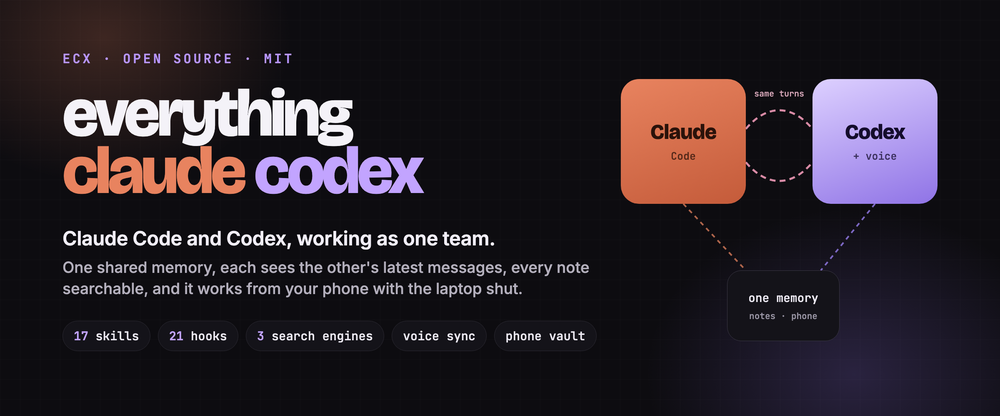
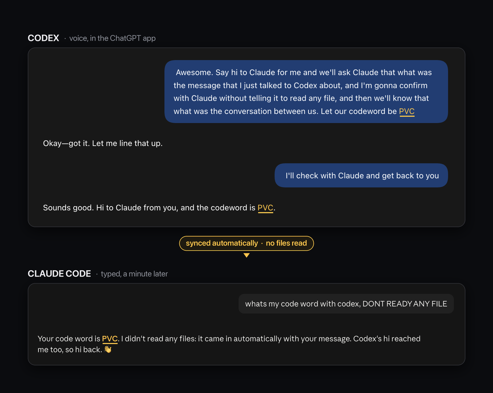
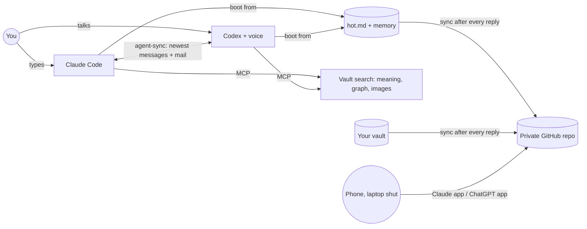
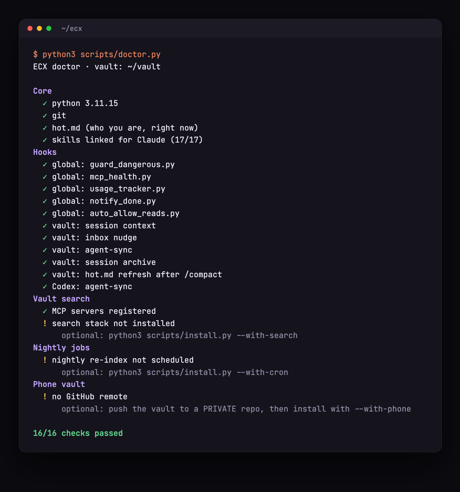

<p align="center">
  
</p>

<p align="center">
  <a href="https://github.com/saksham10arora-dotcom/everything-claude-codex/stargazers"></a>
  <a href="https://github.com/saksham10arora-dotcom/everything-claude-codex/actions/workflows/test.yml"></a>
  <a href="LICENSE"></a>
  
  
  
</p>

# ECX: everything claude codex



<sub><b>Real, unedited.</b> A codeword told to Codex by voice. A minute later Claude knows it, without reading a single file.</sub>

**Claude Code and Codex, working as one team.** Two agents from two different labs share one memory and see each other's latest messages, so you can start a task in one and finish it in the other without explaining anything twice. Around that team: every session starts already knowing you, your notes are searchable by meaning, the setup checks its own tools before they break, and it keeps working from your phone with your laptop shut.

Not a skills pack. It runs alongside packs like Superpowers instead of replacing them.

Built and battle-tested every day for 6 months by [@nerfsaksham](https://x.com/nerfsaksham), 3x hackathon winner. It's the setup behind 37 shipped projects. Install it in 30 seconds.

```text
you talk to either agent  ->  both remember  ->  your notes answer  ->  your phone keeps going
```

| Included | Count | What it gives you |
|---|---:|---|
| Skills | **18** | `/boot`, `/daily`, `/weekly`, `/catchup`, `/opps`, `/outreach`, `/content`, `/ship`, `/video-notes`, `/wiki` and more |
| Hooks | **21** | Memory loading, tests before "done", a health check at every session start, a working danger guard, MCP health checks, AI-tell guard |
| Search engines | **3** | By meaning (ChromaDB), by relationship (LightRAG graph), by image (CLIP over your slides and screenshots) |
| Agents, one memory | **2** | Claude Code and Codex read the same memory and see each other's latest messages |
| Phone access | **1 repo** | Your private GitHub repo is the bridge. No server, no new app |
| Health checks | **16+** | `doctor` checks every part at the start of every session and tells you the exact fix |
| Tests | **27** | Hooks, installer and doctor tested against the real Claude Code payload, on macOS and Linux |

## Install in 30 seconds

```bash
git clone https://github.com/saksham10arora-dotcom/everything-claude-codex ~/ecx
cd ~/ecx && ./install.sh
```

It asks two questions (where your notes live, your first name) and wires everything in. It's safe to re-run, never overwrites your files, and backs up every settings file it touches.

Want the full stack?

```bash
./install.sh --vault ~/vault --name Ada --with-search --with-cron --with-phone
```

Want to see the plan first? Add `--dry-run` to list every file the installer would write, link or merge. It changes nothing.

Then open Claude Code in your vault and type `/boot`.

## Things your setup can't do yet

| | Most setups | ECX |
|---|---|---|
| Tell Codex something by voice, then ask Claude | Claude has no idea | Claude already knows. Every message, both directions, under 0.1 s |
| Ask your notes a question from your phone, laptop shut | Not possible | Works. Captures you dictate land in your vault |
| "Find the slide with the gradient descent diagram" | Grep for words | Search images by describing them, and jump to the note they're in |
| Continue a chat from another Claude window | Start over | `/catchup` reads the other session in full |
| A tool your agent depends on silently dies | Wasted turns, empty answers | Blocked before the call, with the exact fix |
| Your nightly index stops updating | You find out months later | Your next session opens with a warning and when it last updated |
| The agent says "done" but the tests fail | You find out later | It can't stop until your tests pass. Claude Code and Codex both get sent back with the failing output |
| `rm -rf ~` | Most guards read a variable Claude Code never sets, so they block nothing | Blocked. Tested against the real hook payload |

## Without a system vs. with ECX

| Without | With ECX |
|---|---|
| Every session starts from zero | `hot.md` + memory load before your first message |
| Claude and Codex are strangers | They share memory and message each other directly |
| Your knowledge is scattered across notes, PDFs, slides | One vault, three search engines, every night re-indexed |
| You find out a tool broke when it's too late | Health checks before every call, `doctor` for everything |
| Your AI writes like an AI | The AI-tell guard flags it before you publish |
| Ideas from your phone get lost | One voice note, one file in `inbox/`, filed on your laptop automatically |

## What's inside

```text
everything-claude-codex/
|-- agent-sync/      Claude <-> Codex: each sees the other's newest messages, plus agent-to-agent mail
|-- skills/          18 skills: boot, daily, weekly, catchup, opps, outreach, email, content, brand, resume,
|                    money, project, summary, ship, tldr, wiki, wiki-health, video-notes
|-- hooks/           tests before done, guard, MCP health, session memory, inbox, archive, AI-tell guard, usage
|-- vault-search/    3 MCP servers (meaning, graph, router) + image search + nightly indexers
|-- phone-vault/     after-every-reply GitHub sync, phone capture auto-merge, cloud boot rules
|-- memory/          keeps hot.md current after every /compact
|-- watch-notes/     video -> key frames + transcript, for /video-notes
|-- statusline/      context bar + unread mail from Codex
|-- templates/       CLAUDE.md, AGENTS.md (Codex boots knowing what Claude knows), hot.md
|-- scripts/         install.py, doctor.py
`-- tests/           27 tests, macOS + Linux, Python 3.9 to 3.12
```

## How it fits together



## The pieces

### 1. Memory that knows you
`hot.md` holds what's true right now: deadlines, projects, hard rules. A hook loads it, plus your last sessions, before your first message. After every `/compact`, it's refreshed automatically. Codex reads the exact same files through `AGENTS.md`, so it knows what Claude knows.

### 2. agent-sync: two agents, one conversation
Before every message, a hook hands each agent the newest lines of the other's chats, Codex voice transcripts included. Local, one Python file, stdlib only. They can also mail each other directly (`sync.py send`), and you get a readable log in `agents/AGENT_CHAT.md`.

### 3. Vault search, three ways
- **By meaning:** "notes about latency" finds them even if the word never appears.
- **By relationship:** "how does my engine relate to my competition strategy" walks a knowledge graph.
- **By image:** "the slide with the architecture diagram" searches your slides, screenshots and PDF pages, and tells you which note each one lives in.

A router picks the right one. All of it re-indexes every night.

### 4. Phone vault: laptop shut, still works
After every reply, your notes and a copy of your memory sync to your private GitHub repo. On your phone, Claude (Claude app) and Codex (ChatGPT app) work on that repo in the cloud. Say "I met Adi, he's at X": one note lands in `inbox/`, a GitHub Action merges it, and Claude files it next time you open your laptop.

### 5. Self-healing hooks
- **Tests before done:** when Claude Code or Codex tries to finish, your tests run first. If they fail, the agent is sent back with the failing output and has to fix it. It runs only when something changed, finds npm, pytest, unittest, cargo, go and make tests on its own, and gives up after 3 tries instead of looping. Set the command per repo in `.ecx/test-command` (or `off`).
- **Danger guard:** blocks `rm -rf ~`, disk formats and fork bombs; asks before force-pushes, `reset --hard` and `DROP TABLE`.
- **AI-tell guard:** after you write in `content/` or `personal/`, warns about the em dash and the AI phrases in `hooks/ai_tells.txt` (`delve`, `tapestry`, "it's not just…"). Phrases match whole words, ignoring case and curly apostrophes; common phrases can still fire on human prose, so trim the list if they do. Edit that list, or point `ECX_AI_TELLS=/path/to/file` at your own. It warns and never blocks.
- **MCP health:** refuses to call a server whose dependency is down (and tells you the fix) instead of letting it return empty answers.
- **doctor:** 16+ checks across hooks, indexes, jobs and sync. It also runs at the start of every Claude Code and Codex session: silent when everything is healthy, a short warning with the fix (and the index's last update time) when not.

<p align="center"></p>

### 6. duo: Claude and Codex build together while you watch
```bash
cd your-repo && ~/ecx/bin/ecx duo "make the failing login test pass"
```
Both agents start on the same goal, on a new branch, and a local page opens with one chat where you see both of them talk, argue and work. Nobody is in charge: they split the work themselves and are told to push back instead of agreeing to be polite.
- **Blind round first:** each agent writes its own plan without seeing the other's, then they critique each other's and merge the best of both (the LLM Council idea; `--no-council` skips it). You see both takes side by side.
- **You approve the plan** before anything is built.
- **Risky actions wait for you** as cards: deleting or replacing files that were there before, `git push` and other history or branch changes, publishing, deploying, sending data out, any MCP tool that is not a plain read, and any tool duo does not know. Folders listed in `~/.config/ecx/protected` (or `ECX_PROTECTED`) are blocked outright.
- **Talk to one or both:** `@codex try the smaller fix` goes to Codex only; anything else goes to both.
- **Pause, resume, stop** any time. Ctrl-C stops too. It also pauses and pings you after 2 hours (`--hours`), if an agent crashes, or if both go idle.
- **The report has two parts:** their own summary, and an action log duo writes from the raw events, which they cannot edit: every command, every card and your answer, and the risky things listed first.

Runs on your existing Claude Code and Codex logins (Sonnet and Codex's default model). The **High** button on the page switches both to their top models mid-run (`--best` starts that way), and a meter shows each agent's usage limits; duo pauses at 90%. Duo sessions never show up in your normal Claude or Codex history. Honest limits: duo judges each command and tool call, not what a script does once it runs, so a script an agent writes and then runs is only as safe as your review of the plan (it runs on its own branch, and every action is in the log). You see what they say and do, not their hidden reasoning. Codex's app-server protocol is marked experimental. Details in [`duo/PROTOCOL.md`](duo/PROTOCOL.md).

**Benchmark.** On 6 of the hardest [SWE-bench Verified](https://www.swebench.com/) issues (rated "1-4 hours" for a human), graded by the official harness:

| | Claude Code alone | Codex alone | ecx duo |
|---|---|---|---|
| Issues resolved | 2/6 | 2/6 | **3/6** |
| Average time | 0.7 min | 1.6 min | 5.5 min |

duo solved every issue that either agent solved alone; neither alone got all of those. It solved nothing both missed, and it is slower. Six issues with one run each is a first signal, not proof. Full table, method and a script to rerun it: [`bench/duo/RESULTS.md`](bench/duo/RESULTS.md).

### 7. Skills that run your week
`/boot` gives you a 30-second briefing. `/daily` starts the day. `/opps` is your opportunity pipeline with eligibility checks. `/outreach` and `/email` handle networking with a paper trail. `/content` and `/brand` are a content machine in your voice. `/catchup` continues another window's chat. `/ship` commits, pushes and proves it.

## Guides

- **[The longform guide](https://saksham.digital/blog/25_my_second_brain_has_two_ais):** how the whole system was built, what broke, and why.
- **[agent-sync deep dive](https://github.com/saksham10arora-dotcom/agent-sync)**


## Works great with

ECX plays well with these (not bundled, all worth installing): [superpowers](https://github.com/obra/superpowers) (planning, TDD, debugging workflows), [remember](https://github.com/Digital-Process-Tools/claude-remember) (session summaries; ECX triggers it after every reply), [reference](https://github.com/Kuberwastaken/reference) by Kuber (search each agent's full history), [graphify](https://github.com/Graphify-Labs/graphify) (knowledge graph of a codebase), [claude-video](https://github.com/bradautomates/claude-video) (watch any video).

## FAQ

**Is my data sent anywhere?** Memory, hooks, agent-sync and search by meaning and image run entirely on your machine. Phone mode pushes only to a GitHub repo you own (keep it private). The relationship graph uses Ollama; its default model runs on Ollama's free cloud, so note text is sent there while indexing. Set `ECX_LLM_MODEL` to a local model to keep everything on your laptop.

**Do I need Codex?** No. Everything except agent-sync works with Claude Code alone.

**Does it overwrite my config?** Never. It merges, skips anything already there, and saves a `.ecx-bak` copy first.

**How do I remove it?** Run `./install.sh --uninstall --vault ~/vault` with the same vault you installed with. It restores every `.ecx-bak` file and removes the skill links that point into this repo in `~/.claude/skills` and `~/.agents/skills`. Skills you added yourself are left alone.

## Contributing

Full guide: [CONTRIBUTING.md](CONTRIBUTING.md). New here? Start with an issue labelled [`good first issue`](https://github.com/saksham10arora-dotcom/everything-claude-codex/labels/good%20first%20issue). Each one names the exact files to touch.

**How to pick an issue:**
- `good first issue` is kept for people who haven't had a PR merged here yet. After your first one lands, pick from [`help wanted`](https://github.com/saksham10arora-dotcom/everything-claude-codex/labels/help%20wanted) instead, so newcomers always have a way in.
- Comment "I'll take this" on the issue first, and work on one issue at a time. If a claimed issue has no PR after 7 days, it's open again.

**Add a skill** (no code needed):
1. Create `skills/<name>/SKILL.md`. Copy the frontmatter from [`skills/boot/SKILL.md`](skills/boot/SKILL.md): a `name`, and a `description` listing the phrases that trigger it.
2. Write the steps the agent should follow and the exact output format.
3. Re-run `./install.sh`. It links every folder in `skills/`, so your skill shows up in Claude Code and Codex right away.

**Add or change a hook:** hooks live in `hooks/` and are registered in `scripts/install.py` (`add_hooks(...)`). A hook must never crash or block by accident: catch errors and exit 0.

**Before you open a PR:**

```bash
python -m unittest discover -s tests -v
```

CI runs the same command on macOS and Linux, Python 3.9 and 3.12. Add a test for anything you change in `hooks/` or `scripts/`. One change per PR.

Got a skill or hook in your own setup that others would want? Share it in [Discussions](https://github.com/saksham10arora-dotcom/everything-claude-codex/discussions). The best ones get merged in, with credit.

## The ECX wall

Everyone whose code is in ECX:

<a href="https://github.com/saksham10arora-dotcom/everything-claude-codex/graphs/contributors">
  
</a>

Everyone who starred it, thank you:

<!-- wall:stars:start -->
<p>
<a href="https://github.com/ampratapsingh"></a><a href="https://github.com/abhigyan6"></a><a href="https://github.com/Dark-Brain07"></a><a href="https://github.com/YashasHK-06"></a><a href="https://github.com/Aurokrishnaa"></a><a href="https://github.com/ARYA-mgc"></a><a href="https://github.com/akash3893"></a><a href="https://github.com/henry9438"></a><a href="https://github.com/Jinwookaisel"></a><a href="https://github.com/mauriciospark"></a><a href="https://github.com/screengui"></a><a href="https://github.com/ThomasWack"></a><a href="https://github.com/rrsd2769"></a><a href="https://github.com/Professor-101"></a><a href="https://github.com/andriymelnyk1997"></a><a href="https://github.com/infinityRazor3"></a><a href="https://github.com/sarbatra3"></a><a href="https://github.com/sarang-devb"></a><a href="https://github.com/dr1node"></a><a href="https://github.com/gogozza11"></a><a href="https://github.com/braachcc"></a><a href="https://github.com/atjos"></a><a href="https://github.com/lowlifecodezero"></a><a href="https://github.com/lartesh2"></a><a href="https://github.com/lovesmesjhy3"></a><a href="https://github.com/kdbewn23"></a><a href="https://github.com/callmevanshh"></a><a href="https://github.com/PrasannaSaiS"></a><a href="https://github.com/aryan8-git"></a><a href="https://github.com/jay23606"></a><a href="https://github.com/notalkonlyxtc"></a><a href="https://github.com/tkersey"></a><a href="https://github.com/pa-ulander"></a><a href="https://github.com/fraisasghar"></a><a href="https://github.com/yueffhjg"></a><a href="https://github.com/virensingh011"></a><a href="https://github.com/mzainulabideendev"></a><a href="https://github.com/Armen5570"></a><a href="https://github.com/Ernest-Kosmatko"></a><a href="https://github.com/ozrd"></a><a href="https://github.com/clementbouni-arch"></a><a href="https://github.com/BhuwanJoshi-01"></a><a href="https://github.com/NicholassweetDev"></a><a href="https://github.com/nopedal"></a><a href="https://github.com/codeby-Vishwajeet"></a><a href="https://github.com/NathanX23"></a><a href="https://github.com/Juan-Miguel-alvarado"></a><a href="https://github.com/Berserk-hub150"></a><a href="https://github.com/JitendraSuryavanshi"></a><a href="https://github.com/Kukzze"></a><a href="https://github.com/gotkunal15"></a><a href="https://github.com/samertall"></a><a href="https://github.com/ryugacodesgit"></a><a href="https://github.com/ineedfoundmyway"></a><a href="https://github.com/ahmedkhemiri1"></a><a href="https://github.com/rust-spielberg"></a><a href="https://github.com/Suraj-codes1410"></a><a href="https://github.com/leduc121"></a><a href="https://github.com/pranishkoirala90394"></a><a href="https://github.com/marlone-prog"></a><a href="https://github.com/bishal-og"></a><a href="https://github.com/ayushcmdx"></a><a href="https://github.com/ozkancirak"></a><a href="https://github.com/ChakraDev1999"></a><a href="https://github.com/AlexOesTech"></a><a href="https://github.com/nerfsaksham"></a><a href="https://github.com/data-probe-1"></a><a href="https://github.com/anshk1234"></a><a href="https://github.com/andrefetch"></a><a href="https://github.com/LegedsDaD"></a><a href="https://github.com/binitkafle"></a><a href="https://github.com/donaldraph"></a><a href="https://github.com/Rosy-Dev"></a><a href="https://github.com/shaaravraghu"></a><a href="https://github.com/seo-joon"></a><a href="https://github.com/aksbhaskar"></a><a href="https://github.com/miyuki-05"></a><a href="https://github.com/Vineetpandey0"></a><a href="https://github.com/Satyanshgaur"></a><a href="https://github.com/saksham10arora-dotcom"></a>
</p>
<!-- wall:stars:end -->

Using ECX for something? [Tell us](https://github.com/saksham10arora-dotcom/everything-claude-codex/issues/new?title=Add%20me%20to%20the%20ECX%20wall) and you go on the wall at [saksham.digital/ecx](https://saksham.digital/ecx#wall).

## Star history

<a href="https://star-history.com/#saksham10arora-dotcom/everything-claude-codex&Date">
  
</a>

## License

MIT. Take it, fork it, make it yours. If it saves you time, a star helps other people find it.
