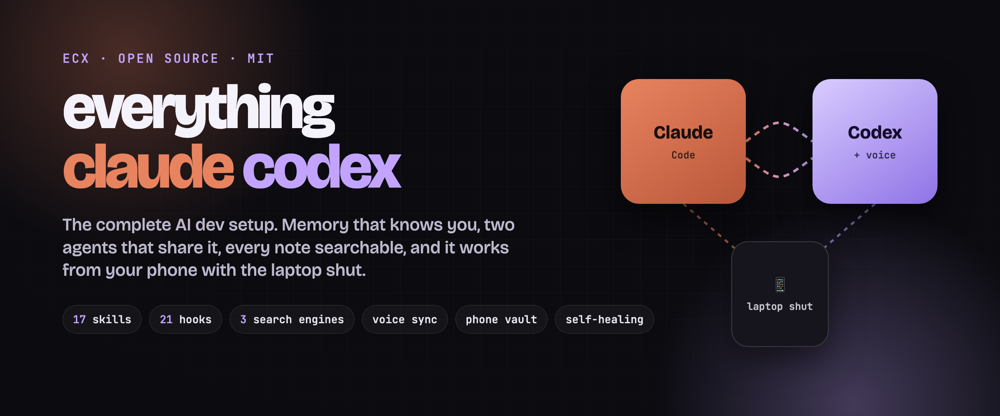
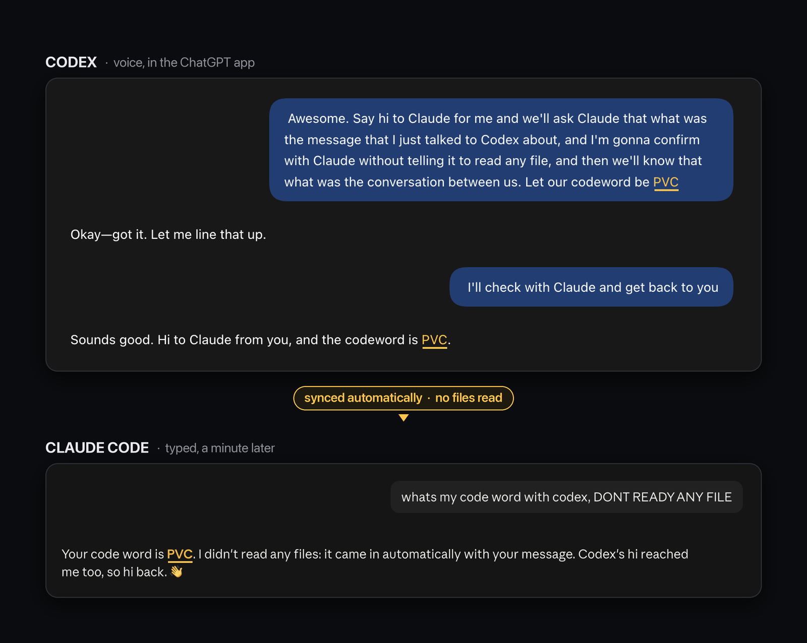
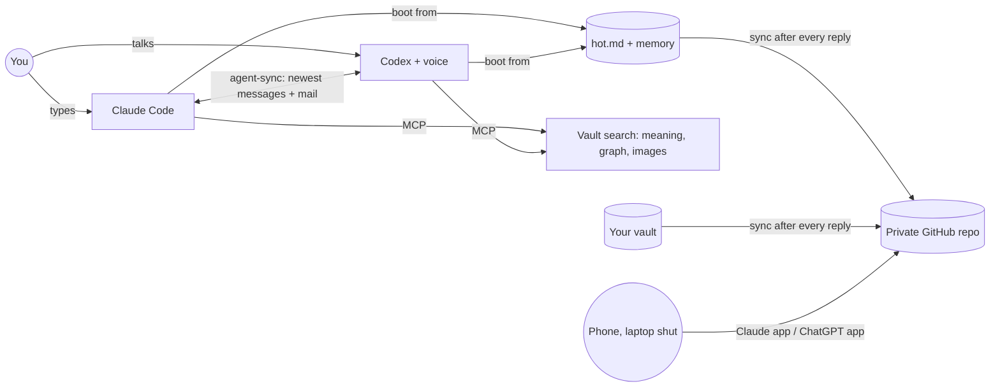
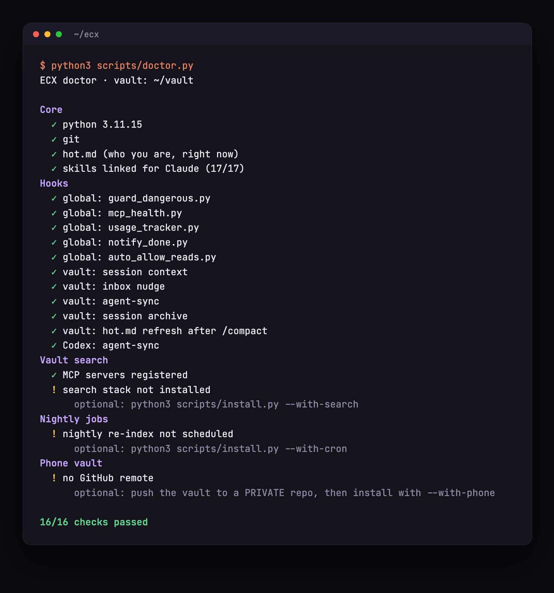

<p align="center">
  
</p>

<p align="center">
  <a href="https://github.com/saksham10arora-dotcom/everything-claude-codex/stargazers"></a>
  <a href="https://github.com/saksham10arora-dotcom/everything-claude-codex/actions/workflows/test.yml"></a>
  <a href="LICENSE"></a>
  
  
  
</p>

# ECX: everything claude codex

**The complete AI dev setup for Claude Code and Codex.** Your agents start every session already knowing you, share one memory with each other (voice included), search everything you've ever written, check their own tools before they break, and keep working from your phone with your laptop shut.

Built and battle-tested every day for 6 months by [@nerfsaksham](https://x.com/nerfsaksham), 3x hackathon winner. It's the setup behind 37 shipped projects. Install it in 30 seconds.

```text
you talk to either agent  ->  both remember  ->  your notes answer  ->  your phone keeps going
```

| Included | Count | What it gives you |
|---|---:|---|
| Skills | **17** | `/boot`, `/daily`, `/catchup`, `/opps`, `/outreach`, `/content`, `/ship`, `/video-notes`, `/wiki` and more |
| Hooks | **17** | Memory loading, a working danger guard, MCP health checks, AI-tell guard, usage tracking, done notifications |
| Search engines | **3** | By meaning (ChromaDB), by relationship (LightRAG graph), by image (CLIP over your slides and screenshots) |
| Agents, one memory | **2** | Claude Code and Codex read the same memory and see each other's latest messages |
| Phone access | **1 repo** | Your private GitHub repo is the bridge. No server, no new app |
| Health checks | **16+** | `doctor` checks every part and tells you the exact fix |
| Tests | **18** | Hooks, installer and doctor tested against the real Claude Code payload, on macOS and Linux |

<p align="center">
  
  <br />
  <sub><b>Real, unedited.</b> A codeword told to Codex by voice. A minute later Claude knows it, without reading a single file.</sub>
</p>

## Install in 30 seconds

```bash
git clone https://github.com/saksham10arora-dotcom/everything-claude-codex ~/ecx
cd ~/ecx && ./install.sh
```

It asks two questions (where your notes live, your first name) and wires everything in. It's safe to re-run, never overwrites your files, and backs up every settings file it touches.

Want the full stack?

```bash
./install.sh --vault ~/vault --name Ada --with-search --with-cron --with-phone
```

Then open Claude Code in your vault and type `/boot`.

## Things your setup can't do yet

| | Most setups | ECX |
|---|---|---|
| Tell Codex something by voice, then ask Claude | Claude has no idea | Claude already knows. Every message, both directions, under 0.1 s |
| Ask your notes a question from your phone, laptop shut | Not possible | Works. Captures you dictate land in your vault |
| "Find the slide with the gradient descent diagram" | Grep for words | Search images by describing them, and jump to the note they're in |
| Continue a chat from another Claude window | Start over | `/catchup` reads the other session in full |
| A tool your agent depends on silently dies | Wasted turns, empty answers | Blocked before the call, with the exact fix |
| Your nightly index stops updating | You find out months later | `doctor` flags it the next day |
| `rm -rf ~` | Most guards read a variable Claude Code never sets, so they block nothing | Blocked. Tested against the real hook payload |

## Without a system vs. with ECX

| Without | With ECX |
|---|---|
| Every session starts from zero | `hot.md` + memory load before your first message |
| Claude and Codex are strangers | They share memory and message each other directly |
| Your knowledge is scattered across notes, PDFs, slides | One vault, three search engines, every night re-indexed |
| You find out a tool broke when it's too late | Health checks before every call, `doctor` for everything |
| Your AI writes like an AI | The AI-tell guard flags it before you publish |
| Ideas from your phone get lost | One voice note, one file in `inbox/`, filed on your laptop automatically |

## What's inside

```text
everything-claude-codex/
|-- agent-sync/      Claude <-> Codex: each sees the other's newest messages, plus agent-to-agent mail
|-- skills/          17 skills: boot, daily, catchup, opps, outreach, email, content, brand, resume,
|                    money, project, summary, ship, tldr, wiki, wiki-health, video-notes
|-- hooks/           guard, MCP health, session memory, inbox, archive, AI-tell guard, usage, notify
|-- vault-search/    3 MCP servers (meaning, graph, router) + image search + nightly indexers
|-- phone-vault/     after-every-reply GitHub sync, phone capture auto-merge, cloud boot rules
|-- memory/          keeps hot.md current after every /compact
|-- watch-notes/     video -> key frames + transcript, for /video-notes
|-- statusline/      context bar + unread mail from Codex
|-- templates/       CLAUDE.md, AGENTS.md (Codex boots knowing what Claude knows), hot.md
|-- scripts/         install.py, doctor.py
`-- tests/           18 tests, macOS + Linux, Python 3.9 to 3.12
```

## How it fits together



## The pieces

### 1. Memory that knows you
`hot.md` holds what's true right now: deadlines, projects, hard rules. A hook loads it, plus your last sessions, before your first message. After every `/compact`, it's refreshed automatically. Codex reads the exact same files through `AGENTS.md`, so it knows what Claude knows.

### 2. agent-sync: two agents, one conversation
Before every message, a hook hands each agent the newest lines of the other's chats, Codex voice transcripts included. Local, one Python file, stdlib only. They can also mail each other directly (`sync.py send`), and you get a readable log in `agents/AGENT_CHAT.md`.

### 3. Vault search, three ways
- **By meaning:** "notes about latency" finds them even if the word never appears.
- **By relationship:** "how does my engine relate to my competition strategy" walks a knowledge graph.
- **By image:** "the slide with the architecture diagram" searches your slides, screenshots and PDF pages, and tells you which note each one lives in.

A router picks the right one. All of it re-indexes every night.

### 4. Phone vault: laptop shut, still works
After every reply, your notes and a copy of your memory sync to your private GitHub repo. On your phone, Claude (Claude app) and Codex (ChatGPT app) work on that repo in the cloud. Say "I met Adi, he's at X": one note lands in `inbox/`, a GitHub Action merges it, and Claude files it next time you open your laptop.

### 5. Self-healing hooks
- **Danger guard:** blocks `rm -rf ~`, disk formats and fork bombs; asks before force-pushes, `reset --hard` and `DROP TABLE`.
- **MCP health:** refuses to call a server whose dependency is down (and tells you the fix) instead of letting it return empty answers.
- **doctor:** 16+ checks across hooks, indexes, jobs and sync.

<p align="center"></p>

### 6. Skills that run your week
`/boot` gives you a 30-second briefing. `/daily` starts the day. `/opps` is your opportunity pipeline with eligibility checks. `/outreach` and `/email` handle networking with a paper trail. `/content` and `/brand` are a content machine in your voice. `/catchup` continues another window's chat. `/ship` commits, pushes and proves it.

## Guides

- **[The longform guide](https://saksham.digital/blog/25_my_second_brain_has_two_ais):** how the whole system was built, what broke, and why.
- **[agent-sync deep dive](https://github.com/saksham10arora-dotcom/agent-sync)**


## Works great with

ECX plays well with these (not bundled, all worth installing): [superpowers](https://github.com/obra/superpowers) (planning, TDD, debugging workflows), [remember](https://github.com/Digital-Process-Tools/claude-remember) (session summaries; ECX triggers it after every reply), [reference](https://github.com/Kuberwastaken/reference) by Kuber (search each agent's full history), [graphify](https://github.com/Graphify-Labs/graphify) (knowledge graph of a codebase), [claude-video](https://github.com/bradautomates/claude-video) (watch any video).

## FAQ

**Is my data sent anywhere?** Memory, hooks, agent-sync and search by meaning and image run entirely on your machine. Phone mode pushes only to a GitHub repo you own (keep it private). The relationship graph uses Ollama; its default model runs on Ollama's free cloud, so note text is sent there while indexing. Set `ECX_LLM_MODEL` to a local model to keep everything on your laptop.

**Do I need Codex?** No. Everything except agent-sync works with Claude Code alone.

**Does it overwrite my config?** Never. It merges, skips anything already there, and saves a `.ecx-bak` copy first.

**How do I remove it?** Restore the `.ecx-bak` files and delete the skill links in `~/.claude/skills`.

## Star history

<a href="https://star-history.com/#saksham10arora-dotcom/everything-claude-codex&Date">
  
</a>

## License

MIT. Take it, fork it, make it yours. If it saves you time, a star helps other people find it.
